# Product Design: аудит интерфейса Shadow Edge GM

Проверка начата 23 октября 2026, отчёт завершён 24 октября 2026 (Europe/Berlin). Исходный checkout: `676143f` (приложение `489ad49`, Fly release 184). Это новый визуальный прогон, не переиспользование старых снимков. Аудит выполнен во встроенном браузере на локальном изолированном JSON-стенде и искусственной UX-кампании. Production-данные, API-ключи и реальные анкеты не читались/не экспортировались. Никакая генерация/оплата не запускалась.

## Вывод

Базовые функции существуют, но общая оболочка не даёт единого визуального поведения. Главные проблемы: перенос чужого target между разделами, недостаточно ясный возврат из публичной мастерской, разные button/form styles, избыточные рамки и высота служебных панелей, конкурирующие CTA, вложенная прокрутка и mobile first-screen density. Успехом будет быстрый переход от выбора кампании к следующему действию и стабильное чтение/редактирование без потери контекста.

## Приоритеты и проверяемый план внедрения

1. **P1: маршруты.** На смене section очищать чужой target/view/context/query; сохранять selection только внутри собственного раздела. Проверить location → sessions → items, Back/reload/deep links; отдельно возврат CharacterRoutes в кабинет. Не повторять мутации при переходе.
2. **P1: общие control styles.** Вынести базовые button/input/select/tab/focus в общую оболочку. `world-maps.css` ограничивает кнопки `.world-maps-page`, которого нет у встроенного MapWorkspace: это подтверждённый исходниками кандидат причины неоформленных map controls. Не лечить проблемные selectors глобальными `!important`.
3. **P1: список записей.** Строка/compact card, единая ширина действий, корректный перенос длинных названий; не помещать карту в 40–60 px колонку. Оптимизация должна распространяться на НПС/квесты/заметки через общий Directory, а не дубли CSS.
4. **P2: оболочка.** На desktop устойчивые rail header/footer, прокрутка только средней навигации; на mobile drawer и доступное закрытие. Плавающий AI не перекрывает CTA/редактор/модалку. Читаемый body 14–16 px, предсказуемые размеры полей, видимый keyboard focus.
5. **P2: главная и сущности.** Один следующий шаг, затем содержимое; не показывать множество пустых секций и повторные быстрые переходы. Редактирование сильнее быстрого просмотра, пустой accordion открывается только по необходимости.
6. **P2: сессии и AI.** Компактный stepper, один статус сохранения; рабочий отчёт не обязан повторять печатную страницу. Пустая evidence-панель не занимает колонку. Видны активный провайдер и следующий шаг подключения.
7. **P2: карты, сцены, бой.** Canvas получает больше площади; библиотека/редактор и contextual tools отделены. Сохранить координаты, подписи, undo, ручной фон, source/playthrough boundaries, Beta. Не менять действия по правилам боя в косметическом пакете.
8. **P2: персонажи и каталоги.** Сначала создание/выбор, затем библиотека и помощь; не смешивать 2014/2024. Общий toolbar каталогов, последовательный mobile flow магазина. Не выдавать новый дизайн за готовый inventory или полную автоматизацию D&D.

## Доказательства по шагам

Снимки 01–24: desktop 1440×1024; для mobile запрошен 390×844, фактические экспортированные кадры 17/23 — 390×844, 18–20 — 381×825. Это исходные байты браузерного снимка, без масштабирования или перекодировки. Снимки 25–27: другая вкладка того же встроенного браузера, собственный viewport 1280×720. Две первоначальные неверные картинки 25/26 были отклонены и заменены проверенными bound-tab screenshots. Снимки из шага 05 и 13 после загрузки перезаписаны более поздним принятым состоянием; boot/loading screens как baseline не приняты.

### 01. Вход — Нужны изменения

Главный вход и путь игрока различимы. На 1440 px заголовок ломается внутри слов («приключе / ний»); форма конкурирует с регистрацией, подпиской и недоступным OAuth. Локально OAuth отключён специально: это ограничение стенда, не вывод о production.

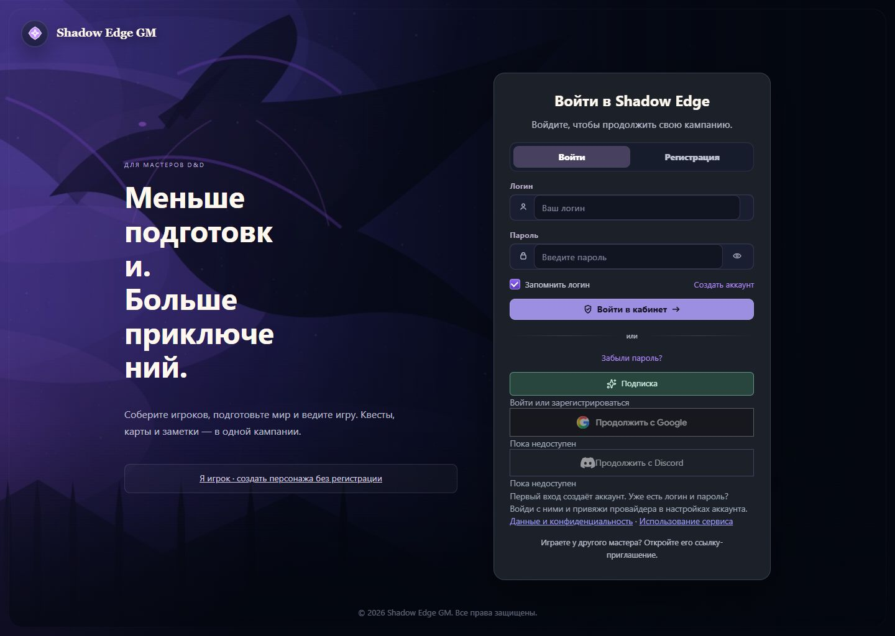

### 02. Стол мастера — Нужны изменения

Есть явный следующий шаг и последняя сессия. Много вложенных рамок и пустых блоков; меню прокручивается отдельно, аккаунт уходит вниз. Сократить onboarding до одной задачи и сворачивать пустые вторичные разделы.

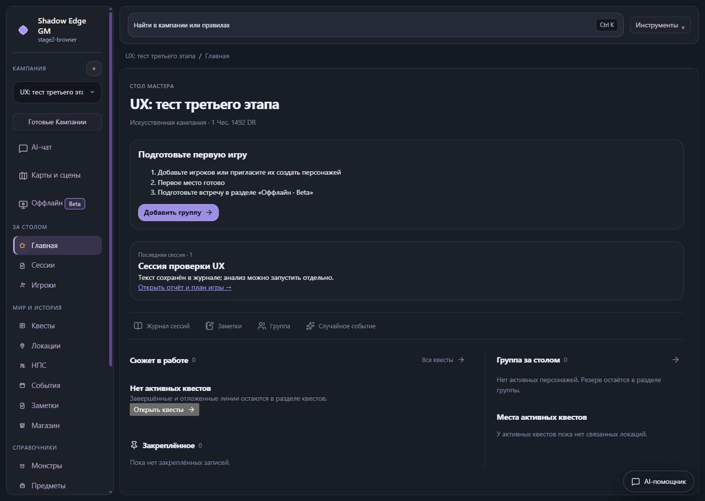

### 03. Список локаций — Высокий приоритет

110 записей читаются постранично; поиск и создание доступны. Ссылка «Карта или сцена места» занимает узкую колонку и раздувает каждую карточку. Перевести обычные записи в строки/компактные карточки, действия — в общий action-row.

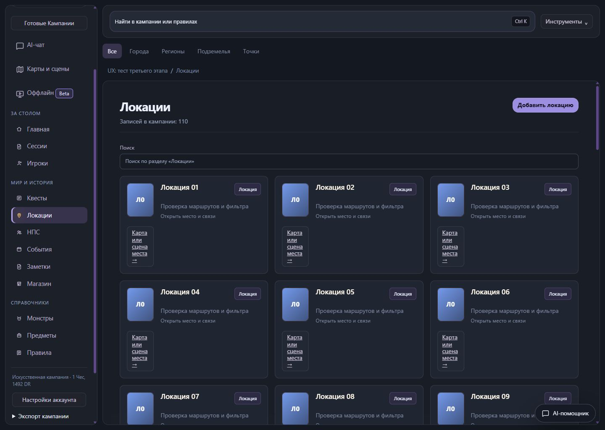

### 04. Карточка записи — Нужны изменения

Хорошо отделены сведения мастера и игроков. Быстрый просмотр визуально сильнее редактирования; слишком много рамок и пустых accordion-секций. Сводка должна быть короче, текст — доступен без дополнительного открытия.

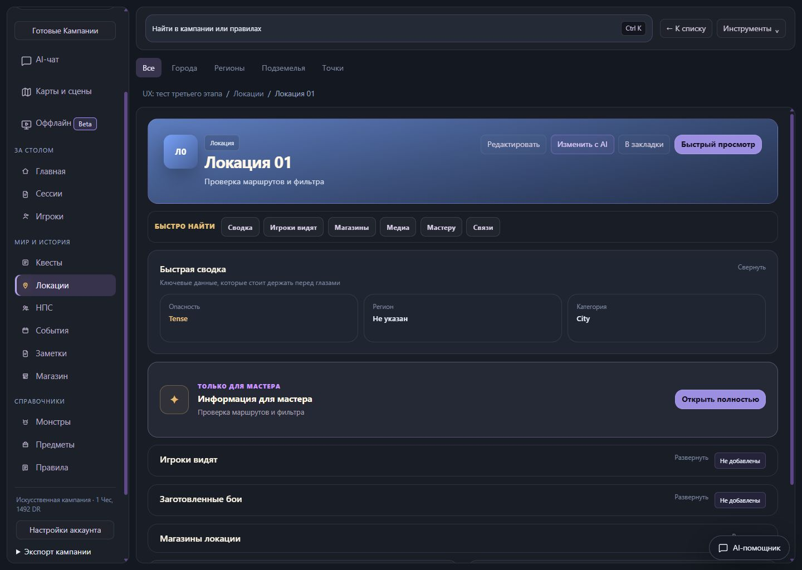

### 05. Редактирование — В основном работает

Есть короткая основная форма, раскрываемые дополнительные поля, отдельное удаление и закреплённое сохранение. Tab после закрытия попадает в скачивание черновика. Неизменённая форма в захваченном состоянии показывает «Сохраняю черновик»; длительность этого состояния отдельно не измерена. Уменьшить высоту статуса и уточнить начальную dirty-базу.

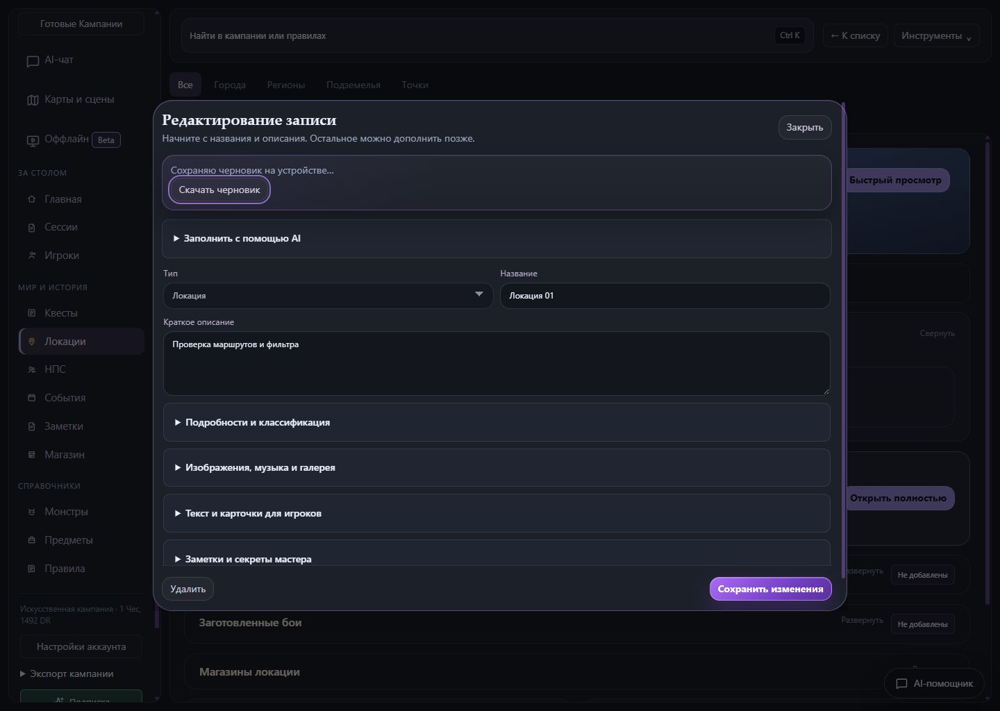

### 06. Переход локация → сессии — Ошибка воспроизведена

Боковое меню сохраняет ID локации в /sessions/{location-id}. Возникает «Сессия не найдена», хотя импортированная сессия видна в списке. Смена раздела должна сбрасывать чужой target; затем Back/reload должны сохранять только допустимый ID.

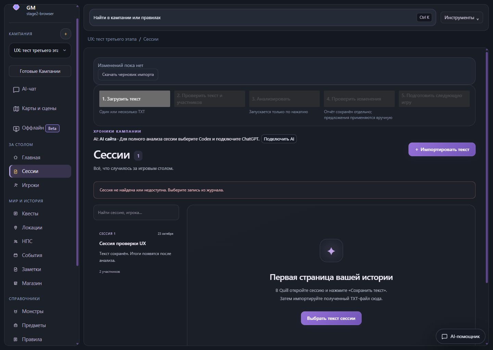

### 07. Открытая сессия — Нужны изменения

Выбор настоящей сессии восстанавливает отчёт; видны сохранённый текст и причина недоступности анализа. Над содержимым слишком высокие блоки черновика/пяти шагов; вложенные вкладки и отдельный светлый отчёт создают несколько визуальных уровней. Свести верх к компактному прогрессу, печатный вид отделить от рабочего.

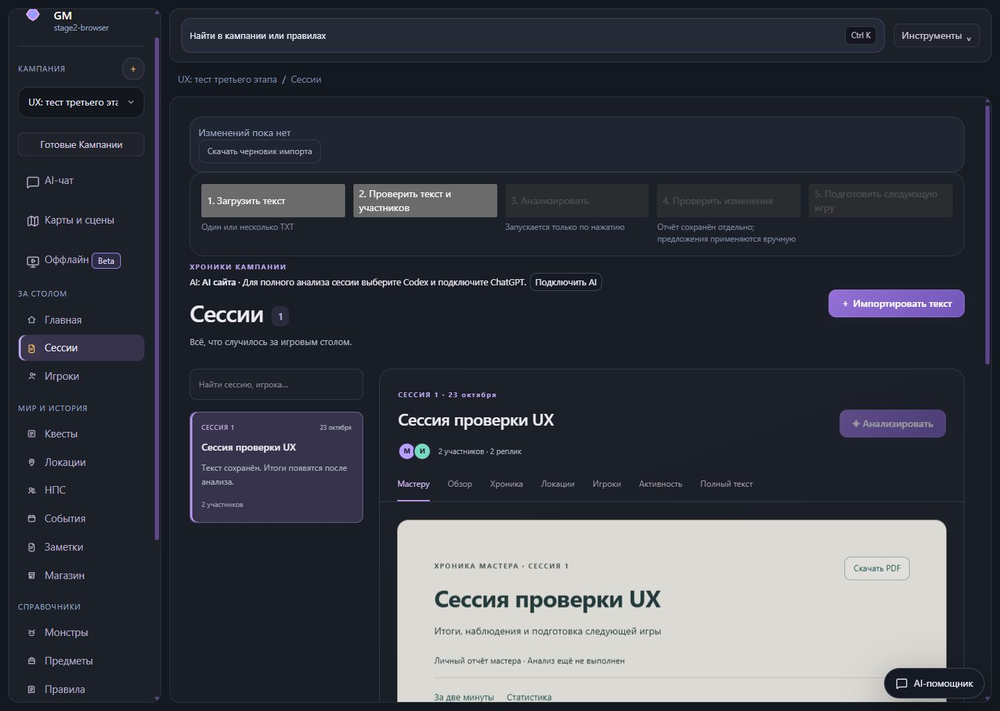

### 08. Предметы — Нужны изменения

Источник и собственные предметы разделены, есть фильтры. Экспорт растянут на всю ширину, импорт выглядит как системный input, карточки чрезмерно высоки. Нужен общий toolbar и единый формат цены без переноса единиц на множество строк.

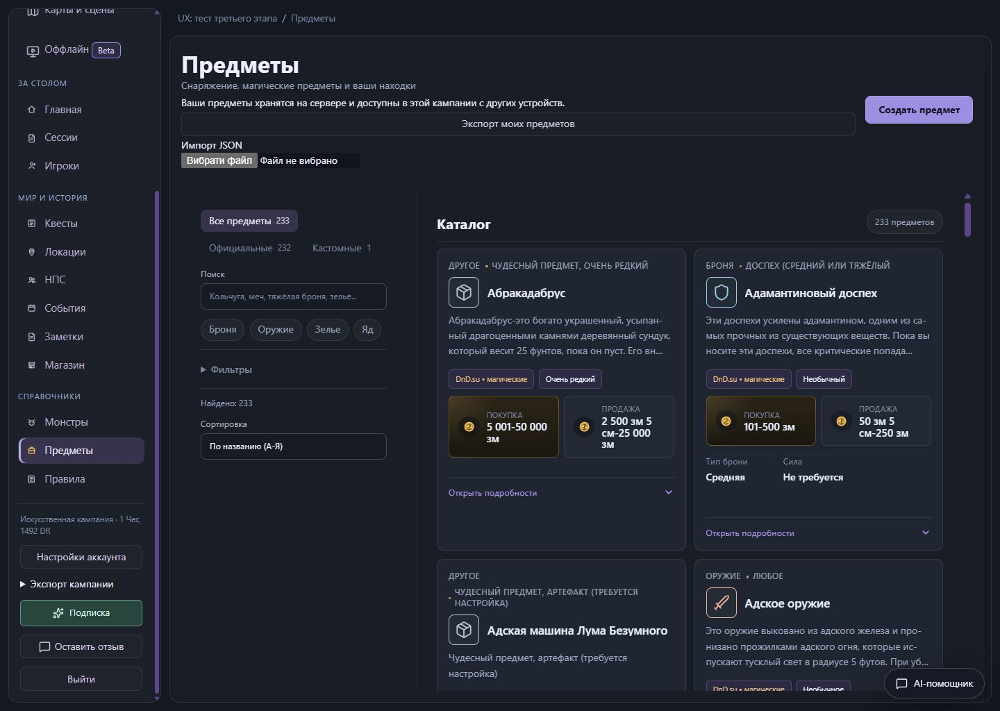

### 09. Карта и Креатив — Высокий приоритет

Существующая карта с 56 объектами открывается, инструменты подписаны, undo/save различимы. Верхние tabs/создание/thumbnail выглядят как неоформленные browser controls; canvas начинается слишком низко. Объединить шапку, убрать дубли рамок, сохранить геометрию и поведение холста.

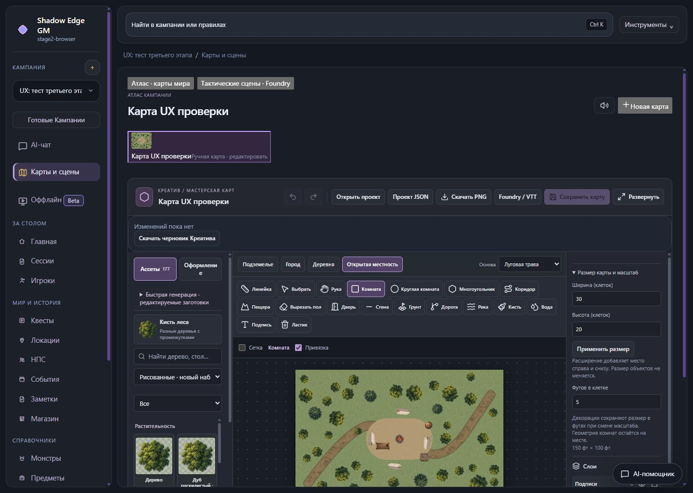

### 10. Библиотека сцен — Высокий приоритет

Понятны отдельные library/create/history. Поле поиска и верхние tabs не получают общий вид приложения, пустое состояние расходует большой экран. Нужен один заголовок с CTA и короткая полезная пустая подсказка.

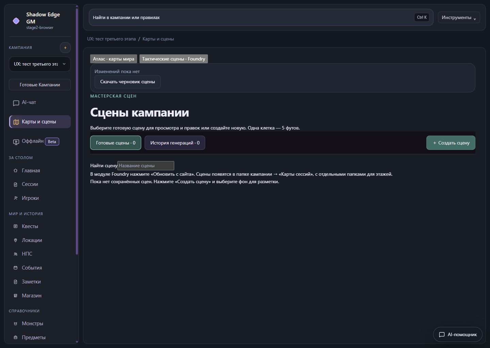

### 11. AI-чат — Нужны изменения

Доступность AI и подтверждение записей объяснены. При пустом диалоге справа занята большая область пустыми материалами, а сверху конкурируют контекст/категории/подсказки. Показать контекст компактно, рабочую панель раскрывать при наличии результата. Генерацию не запускали.

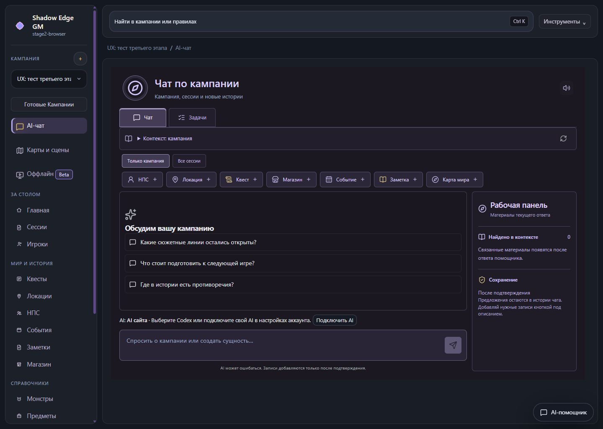

### 12. Оффлайн Beta — В основном работает

Отдельный раздел, честный Beta и зависимость от интернета, недоступная инициатива объяснена. Четыре одинаково крупные карточки и повтор Beta перегружают вход. Сохранить название пользователя и явный статус; сгруппировать инструменты вокруг текущего боя.

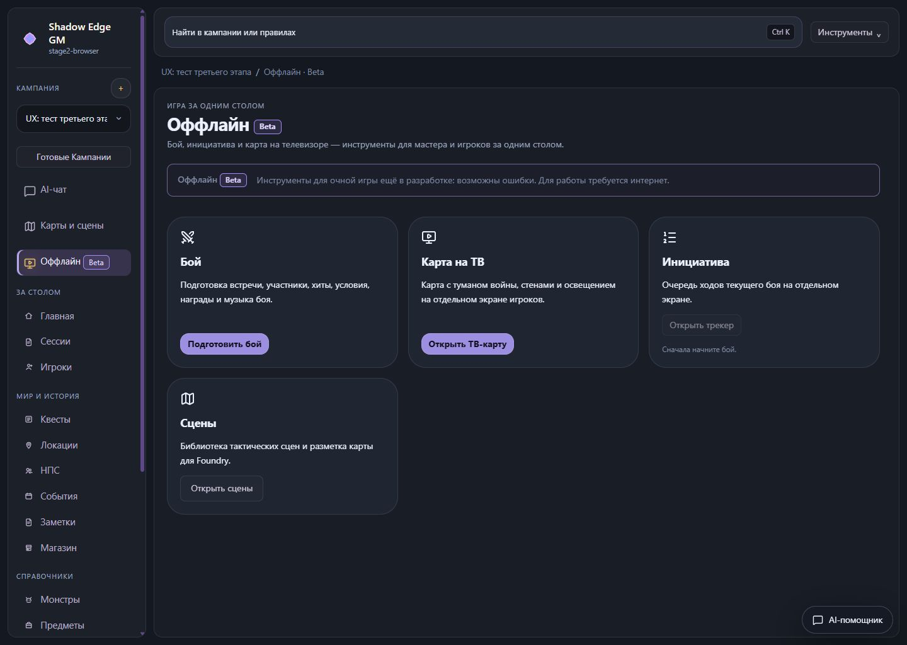

### 13. Подготовка боя — Нужны изменения

Три понятные зоны: группа, противники, каталог. Каталог загрузился; без группы запуск заблокирован с причиной. Большая пустая центральная зона и низкая панель действий; глобальная навигация исчезает. Активный бой не начинали.

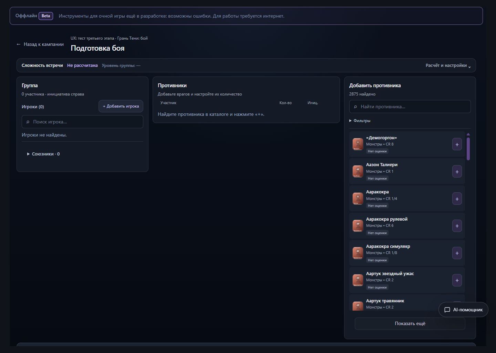

### 14. Выход из подготовки — Требует исправления

После открытия подготовки без ручных правок возврат показывает предупреждение о несохранённом. «Назад к кампании» сначала закрывает подготовку на экран боя; до Оффлайн нужен ещё один шаг. Проверить false dirty и привести текст действия к фактическому назначению.

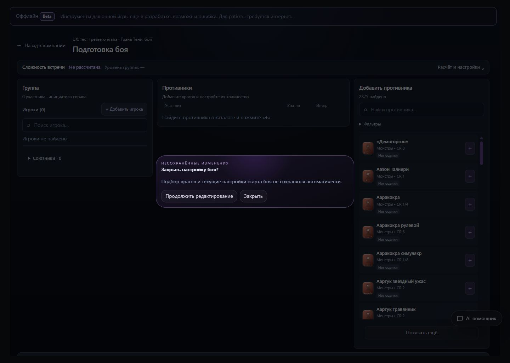

### 15. Магазин — Нужны изменения

Сохранение/отмена и ассортимент отдельные. Статус черновика, выбор магазина, описание и несколько самостоятельных save-действий занимают много места; breadcrumb отображает shops вместо русского названия. Общая шапка и явное разграничение сведений магазина/остатков.

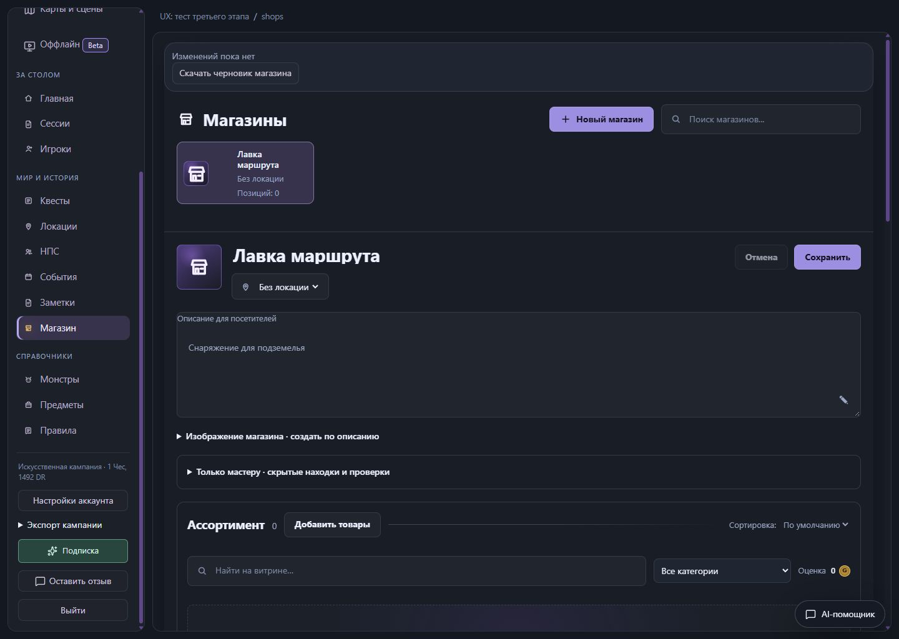

### 16. Настройки аккаунта — Нужны изменения

Есть выбор провайдера, шаги Codex, свёрнутые recovery/OAuth. Состояние «Сейчас AI сайта» расходится с выбранным в форме Codex без явной подписи «ещё не применено». Упростить различие выбора и активного подключения. Отключение Codex на стенде ожидаемо.

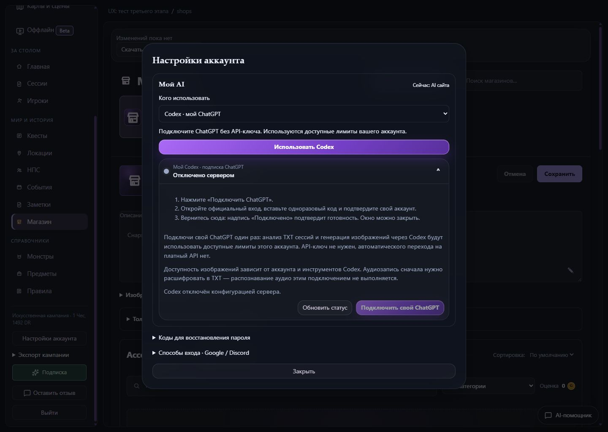

### 17. Настройки на 390 px — Нужны изменения

Поля помещаются по ширине; личный ключ не вводился. Длинные объяснения вытесняют закрытие за нижний край. Нужны компактная помощь и доступная закреплённая кнопка закрытия. API-хранилище на стенде отключено; production-готовность здесь не оценивалась.

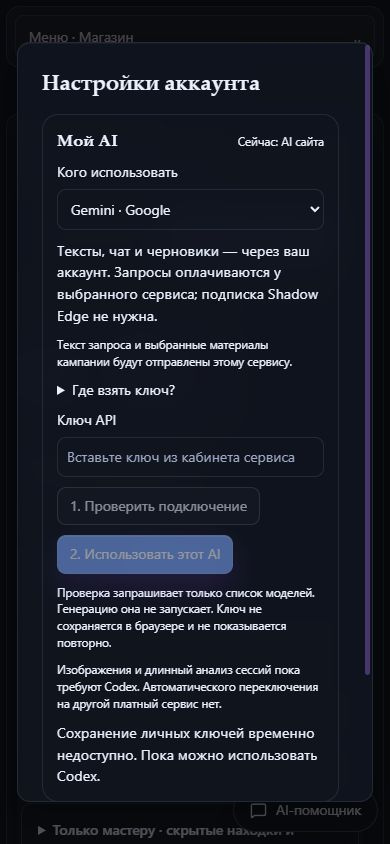

### 18. Магазин на 390 px — Нужны изменения

Поля и сохранение видны, горизонтального разрыва на снимке нет. Сначала показывается длинная форма; ассортимент далеко ниже. Перейти к последовательному выбору магазина/ассортимента и сократить пустую высоту описания.

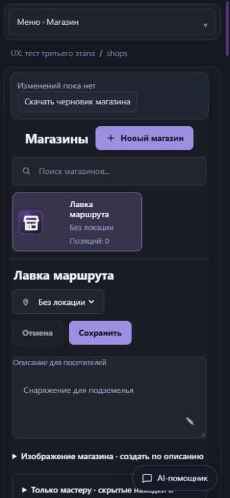

### 19. Меню на 390 px — Нужны изменения

Основные разделы доступны и меню закрывается по выбору. Раскрытое меню занимает почти весь viewport, нижние пункты и аккаунт требуют скролла; плавающий AI перекрывает область снизу. Нужна компактная drawer-навигация с отдельным footer.

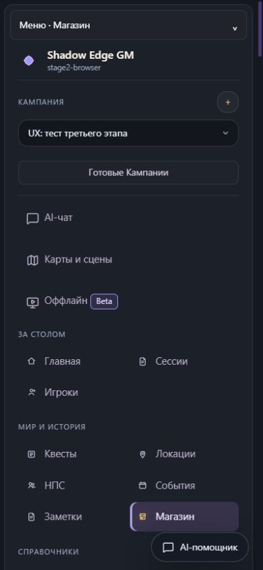

### 20. Локации на 390 px — Высокий приоритет

Создание доступно. Поиск/инструменты/табы/breadcrumb/header занимают большую долю первого экрана; первая запись и действие карты уходят вниз. Плавающий AI конкурирует с областью действия. Проверять 44 px targets и перестроение при 200% zoom отдельно.

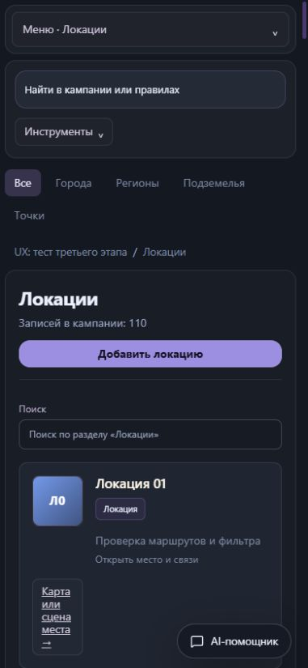

### 21. Вход в мастерскую героя — Нужны изменения

Редакции явно разделены, локальное хранение честно описано. Блок библиотеки занимает верх даже когда героев нет; CTA создания ниже первого экрана. Показать основной выбор правил раньше, помощь по переносу — по запросу.

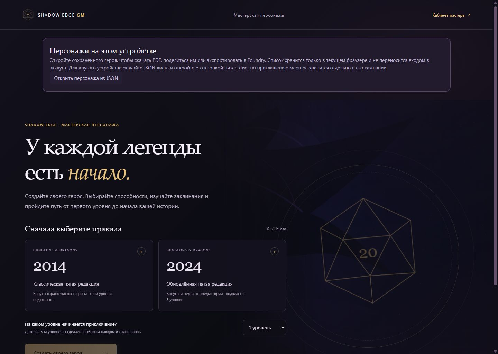

### 22. Первый шаг героя — Нужны изменения

Один класс, прогресс и предпросмотр листа сохранены. После входа первый снятый viewport начинается ниже шапки; снизу фиксированный footer, в центре длинный выбор классов. Восстановить фокус/начало шага, сделать компактнее сводку и не смешивать выбор с полнотой механик.

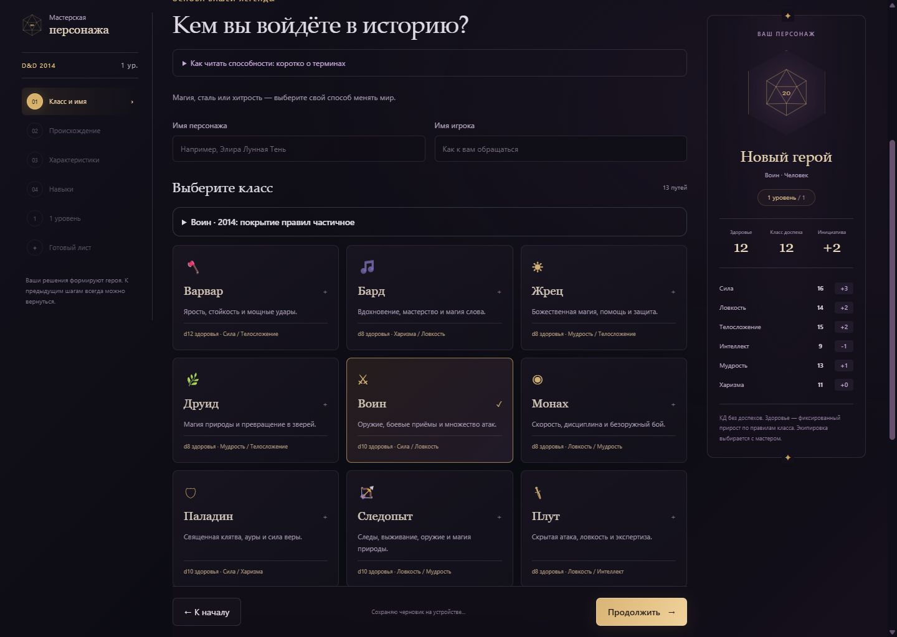

### 23. Герой на 390 px — В основном работает

Ширина документа 390 при viewport 390, нижний CTA доступен. Верх текущего шага частично выше viewport, текст карточек мал, активный выбор требует понятного состояния. Проверить scroll/focus между шагами; полный мастер/PDF здесь не проходили.

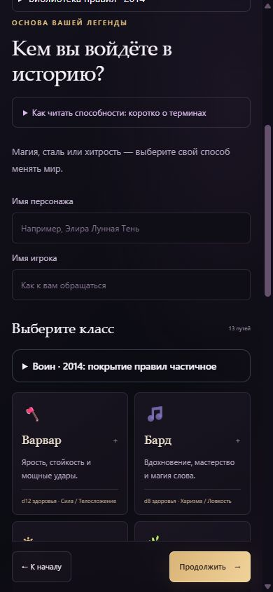

### 24. Герой → кабинет — Ошибка наблюдалась

Нажатие «Кабинет мастера» меняет адрес на /#, но наблюдаемый экран остаётся мастерской; нет JS dialog. Снимок и DOM сохранены. Причина требует проверки взаимодействия глобального перехвата ссылок и hash-routing; reload в этом же сеансе не подтвердил успешный возврат. Не объявлять исправленным без повторного browser-теста.

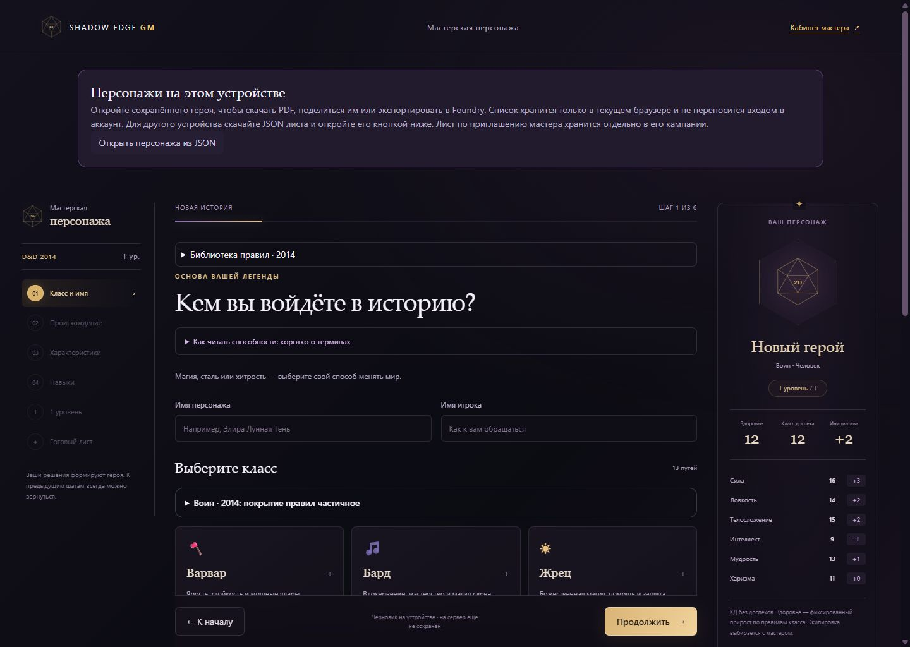

### 25. Группа и листы — Нужны изменения

Приглашение заметно, серверные листы объяснены. Два соседних empty-state сценария «листы игроков» и «Игроки» конкурируют, различие карточки игрока и листа неочевидно. Одна точка входа с явным выбором пригласить/добавить вручную.

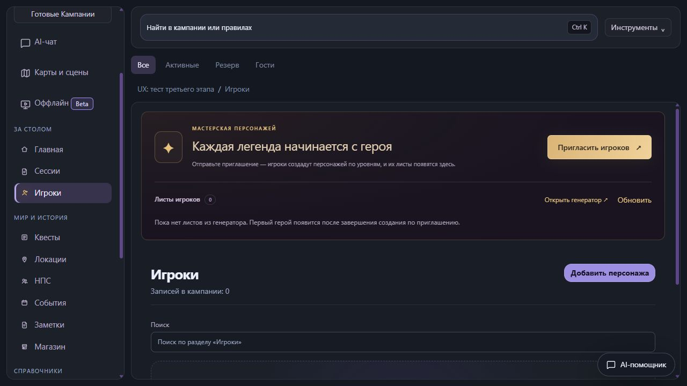

### 26. Правила — Нужны изменения

Есть поиск, категории, источник, краткий и полный режим. Панель результатов мала по высоте, несколько вложенных scroll-областей, статья окружена карточками с повторной метаинформацией. Нужен reader-layout с устойчивым оглавлением. Полнота SRD/правил не проверялась.

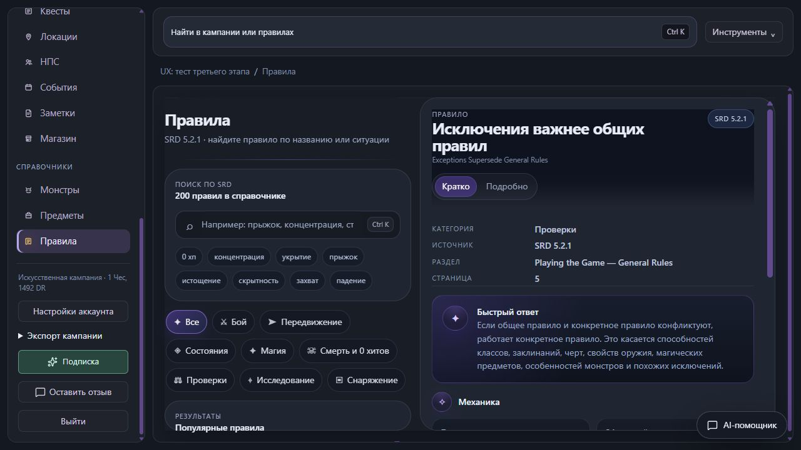

### 27. Бестиарий — Нужны изменения

Фильтры и список существ доступны. Нет единой шапки уровня других каталогов; фильтры занимают много места, карточки преимущественно состоят из заглушек. Нужен единый каталог с компактными строками/предпросмотром. Качество внешних исходных данных не оценивалось.

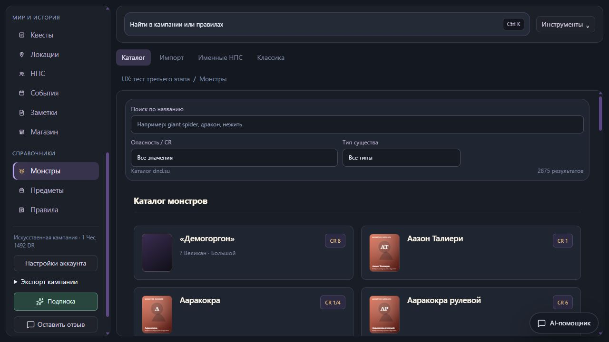

## Доступность и границы

Это комбинированный UX/visual review с частичной keyboard/DOM-проверкой; он не подтверждает соответствие WCAG. Проверены подписанные поля/кнопки в наблюдаемых состояниях, Tab внутри редактора, ширина mobile builder. Риски по скриншотам: мелкие вторичные подписи, плотность/высота targets, перекрытие fixed AI, повторные scroll regions. Контрастные отношения, screen reader, 200% zoom во всех редакторах, reduced motion и вся клавиатурная цепочка требуют отдельной инструментальной проверки.

Не пройдены: все уровни/классы/PDF героя, live AI/provider auth, загрузка и распознавание реального TXT, активный бой/TV на отдельном устройстве, Foundry import, все ready-reader страницы, admin и production error/failure сценарии. НПС/квесты/заметки/события требуют финального визуального обхода после общих исправлений, несмотря на общий Directory. Этот отчёт не заявляет, что каждый скрытый экран приложения исследован.

## Выбранное направление и внедрение

Пользователь выбрал **вариант 3**. Порядок прежних макетов закреплён по появлению в чате: [1](concept-1.png), [2](concept-2.png), [3](concept-3.png). Это концепты с искусственными данными; новые рабочие снимки находятся в `after/`. Внедрение выполнено внутри существующего React-приложения, без подмены backend отдельным прототипом.

Общая оболочка: панель быстрых переходов, компактное меню, устойчивый account footer, mobile menu/Escape; единые dark surfaces и primary/focus в разделе и portal-окнах. Запись: чтение master content без модального шага, настоящая широкая иллюстрация при наличии art, компактная сводка и отдельные связи; preview временно занимает место связей. Списки: исправлена узкая ссылка карты, уменьшены карточки/пустые состояния; импорт/экспорт предметов и локальная библиотека героя раскрываются явно. Карты: исправлен scope нативных controls, сохранены редакторы/геометрия. Журнал: компактнее служебные блоки и темный экранный отчёт, печатный вид отдельный. AI: панель материалов появляется при наличии материала ответа. Правила: reader без второго scroll у статьи. Группа: полные листы и краткие карточки мастера названы отдельно.

Подтверждены browser-проверкой исправления location → sessions → items и public workshop → workspace. Для подготовки боя проверены clean exit и изменённый состав → confirm → прямой возврат в Оффлайн. Entity editor: изменение → warning → продолжить → save → reload; сохранённое значение осталось. Платный AI не запускался. Данные только искусственного локального стенда; production кампании не менялись.

Критерии и итерации сравнения, реальные размеры снимков, принятые отличия от иллюстративного содержимого макета и оставшиеся границы проверки: [design-qa.md](../../../design-qa.md). Новый UI не закрывает отдельные backend/product задачи исходного аудита: inventory, облачная библиотека, полный coverage D&D, история/архив и недоступные интеграции. Полный WCAG, все сценарии боя/TV/Foundry и каждый экран правил/мастерской этим пакетом не сертифицируются.

Исходные 27 снимков и три концепта сохранены без перезаписи, их SHA/форматы — `evidence.json`; новые browser captures — `after/evidence.json`. PNG-концепты не выдаются за работающий интерфейс. Проверки исходников: web TypeScript/production build, workspace routes, device drafts, authoring transport, compact workspace responses, diff check.

Итоговое внедрение опубликовано как Fly release187. Анонимные health/access и совпадение JS/CSS подтверждены в [production-check.json](production-check.json); сценарии редактирования/боя выполнялись только на изолированном стенде.
